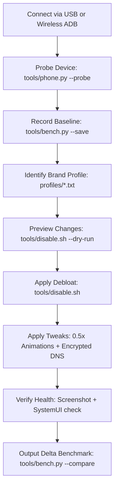

# AGENTS.md — AI Agent Operating Instructions & Safety Policy

This document defines strict guardrails, operating procedures, and safety rules for AI coding agents (**Claude Code**, **OpenAI Codex**, **Gemini CLI**, **Cursor**, **Windsurf**, **Aider**) operating on Android devices through `cleanyourphone`.

---

## 🛡️ Core Rules & Inviolable Directives

### Rule 1: Non-Destructive Modifications Only
- **NEVER** execute `pm uninstall` or `pm uninstall -k --user 0` on system applications.
  - *Reasoning*: `pm uninstall` removes APK references from the user profile. Reinstalling often requires APK extraction, root, or a factory reset.
- **ALWAYS** use `pm disable-user --user 0 <package>`:
  - Completely freezes the package, suspends all background processes, stops battery drain, and removes launcher icons.
  - 100% reversible in one second via `pm enable <package>`.

### Rule 2: The Blacklist (Never Disable)
Agents MUST NEVER attempt to disable, freeze, or uninstall any package matching these critical categories:

| Category | Protected Packages | Failure Consequence |
| :--- | :--- | :--- |
| **Telephony & Dialer** | `com.android.phone`, `com.android.server.telecom`, `com.android.incallui`, `com.sh.smart.caller` | Inability to place or receive calls |
| **Emergency Services** | `com.android.emergency` | 911 / 112 SOS call failure |
| **System UI & Lockscreen** | `com.android.systemui`, `com.android.keyguard`, `com.transsion.keyguardclock`, `android` | Black screen / SystemUI crash loop |
| **Google Play Suite** | `com.android.vending`, `com.google.android.gms`, `com.google.android.gsf` | App crashes, broken push notifications, lost app store |
| **Hardware Camera** | `com.transsion.camera`, `com.android.camera` | Camera hardware inaccessible |
| **Biometrics & Security** | `com.fpsensor.*`, `com.transsion.faceid`, `com.android.keychain` | Fingerprint and face unlock broken |
| **Settings & Permissions** | `com.android.settings`, `com.android.packageinstaller`, `com.google.android.permissioncontroller` | Inability to install APKs or alter settings |

### Rule 3: Always Back Up Before Modification
Before applying any debloat manifest or shell tweaks:
1. Dump the list of active and disabled packages:
   ```bash
   adb shell pm list packages -d > backups/baseline_disabled.txt
   adb shell pm list packages -e > backups/baseline_enabled.txt
   ```
2. Capture a baseline screenshot:
   ```bash
   python3 tools/phone.py --screenshot backups/baseline_screenshot.png
   ```
3. Record hardware baseline metrics:
   ```bash
   python3 tools/bench.py --save backups/baseline_bench.json
   ```

### Rule 4: Always Verify Stability Post-Change
After disabling packages or altering settings:
1. Test screen wakefulness:
   ```bash
   adb shell dumpsys power | grep "mWakefulness"
   ```
2. Verify System UI is alive:
   ```bash
   adb shell pidof com.android.systemui
   ```
3. Capture a post-optimization screenshot:
   ```bash
   python3 tools/phone.py --screenshot backups/post_screenshot.png
   ```

---

## 📋 Recommended Agent Workflow



---

## 🚨 Disaster Recovery Protocol

If an agent or user reports an issue (e.g., black screen, missing UI component, app crash):

### Level 1: 1-Click Restore
Run the automated restore script:
```bash
./tools/restore.sh backups/last_disabled.txt
```

### Level 2: Target Package Re-Enable
If an individual package was disabled by mistake:
```bash
adb shell pm enable <package_name>
```

### Level 3: Safe Mode Recovery
If device UI is unresponsive:
1. Reboot phone into safe mode:
   ```bash
   adb reboot safe
   ```
2. In safe mode, third-party and disabled system apps reset to default state.
3. Re-enable all packages and reboot normally:
   ```bash
   ./tools/restore.sh
   adb reboot
   ```
